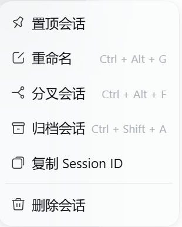
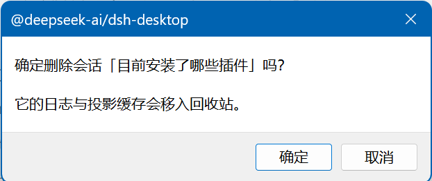

# dsh-session-delete

**English** | [简体中文](README.zh.md)

Adds **「删除会话 / Delete session」** to the sidebar's Session context menu in
[DeepSeek Harness](https://github.com/deepseek-ai) and performs a real,
recoverable deletion.






## What it does

Hover a session row and click its **⋯** button → **Delete session**.

| Session state | Behaviour |
|---|---|
| **Cold** (not loaded in this app run) | Deleted immediately; its log and replay cache go to the Windows **Recycle Bin** (fallback: `<DSH_HOME>/.session-trash/`). The sidebar list refreshes itself through the client Session controller — no page reload needed. |
| **Live** (the session open right now, or one opened earlier in this run) | DSH exposes no "close a session" API, so the files cannot be removed safely. The plugin offers to **queue** it: `POST /dsh-session-delete/queue` writes `<DSH_HOME>/.session-delete-queue.json`, and the **next start** drains that queue before anything is opened. |

After a restart that removed queued sessions, a small notice in the corner lists
what was deleted (titles, up to five, with a count for the rest) and reports any
entry that could not be removed and stays queued.

## Files removed

For one session id:

| Path | What |
|---|---|
| `<DSH_HOME>/sessions/<project>/session-<id>/` | the append-only event log |
| `<DSH_HOME>/storages/session_projcache/sessions/<id>.json` | the replay/projection cache |

Nothing else is touched. Attachments are shared, content-addressed blobs and are
deliberately left alone. The Workspace registry keeps its `sessionIds` entry —
the registry has no "unregister a session" API, and the sidebar already skips ids
whose stored session is gone.

## Safety

- A **live** session is refused (`409`); only the queue path can remove it, on the
  next start.
- The HTTP routes sit behind the Host's browser trust fence
  (`connection.requestRejection`) and accept only `session-<uuid>` ids.
- Deletions are recoverable: Recycle Bin, or a stamped directory under
  `<DSH_HOME>/.session-trash/`.

## Requirements

- DeepSeek Harness 0.2.x (the `sidebar.workspaces.session.menu.item` and
  `shell.overlay` slots).
- Windows for Recycle Bin support; on other platforms files fall back to the
  trash directory.

## Install

Listed in the plugin market once the registry entry is merged. Manual install:

```sh
dsh plugin --profile desktop add github:ashulam/dsh-session-delete
# or from a local checkout:
cd <profile dir>
pnpm add file:<path to this repo>
# then add "dsh-session-delete" to dsh.profile.bundles in package.json
```

## Layout

- `lib/index.js` — host half: `POST /dsh-session-delete/delete`,
  `POST /dsh-session-delete/queue`, `GET /dsh-session-delete/last-drain`
  (plus the boot-time queue drain).
- `client/client.js` — browser half: the context-menu entry and the boot notice.
- `cordis.patch.yml` — inserts the host row into the profile.

## License

MIT